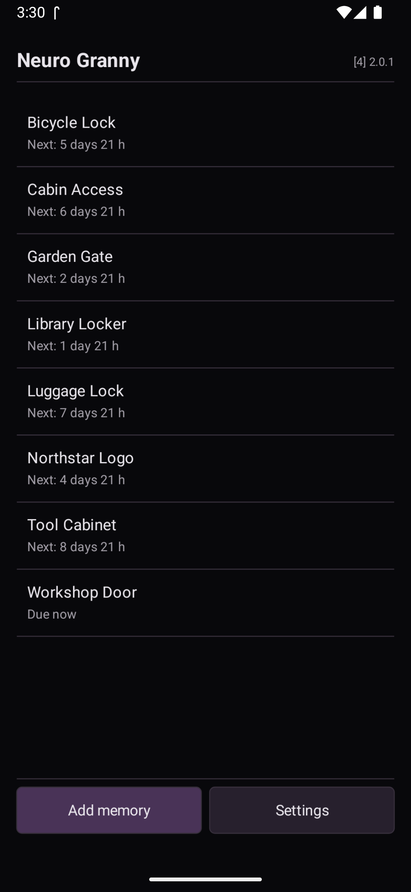
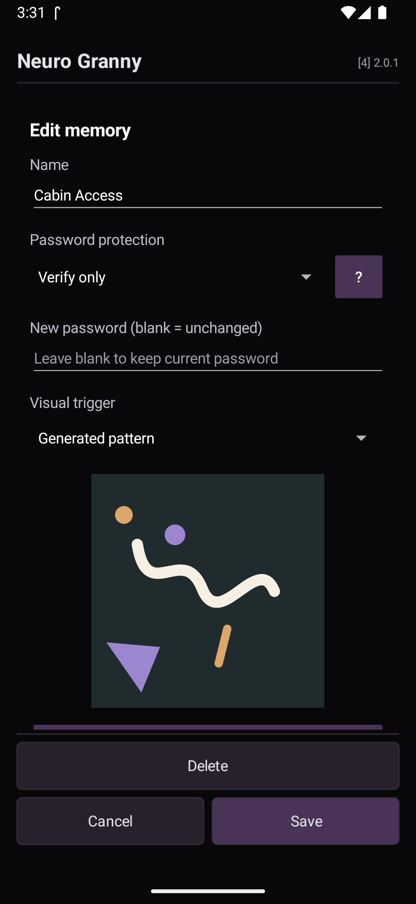
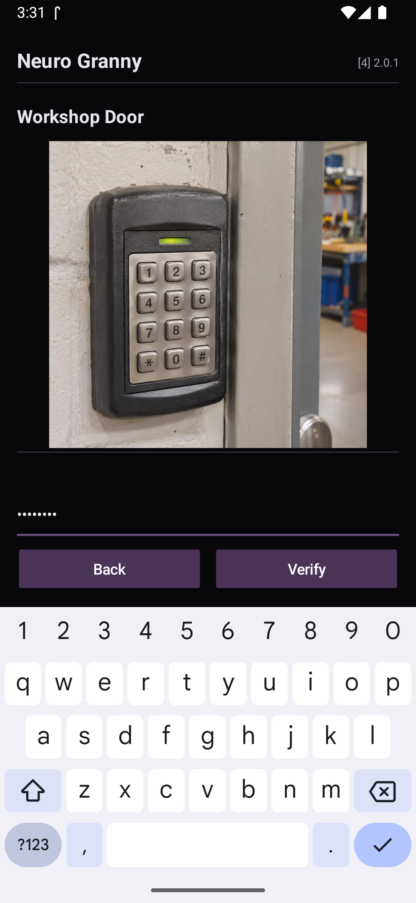
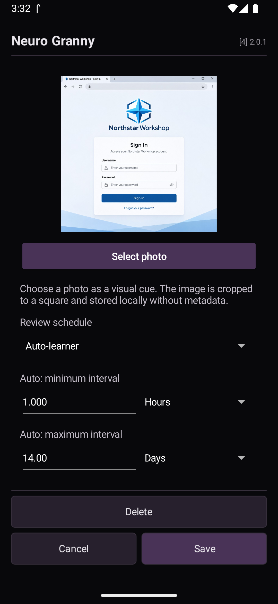
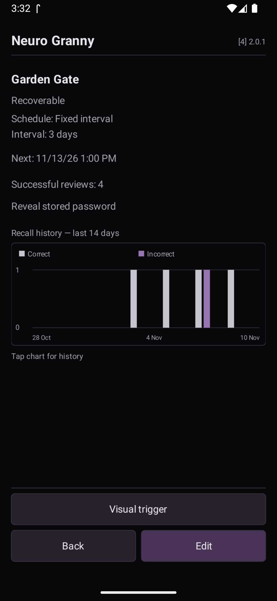
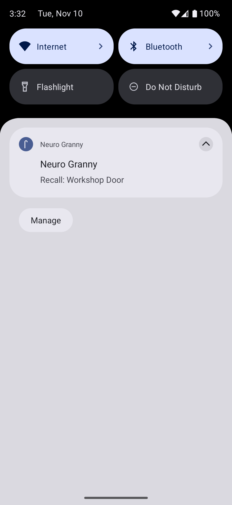

<h1>
  
  Neuro Granny
</h1>

**A password reminder and memory-training app for Android.**

Neuro Granny regularly challenges you to recall passwords, PINs, access codes, and other things worth remembering.

No accounts, no cloud, no synchronization. Just your memory and a little practice.

## Screenshots

<p align="center">
  
  
  
</p>

<p align="center">
  
  
  
</p>

## Why I made this

It started with bicycle lock combinations, door access codes, locker room PINs and similar things. I sometimes need these codes only once every few weeks or months - just rarely enough to forget them, but frequently enough that I really should remember them. So I built a small app that would occasionally ask me for these codes, forcing me to recall them rather than look them up.

Eventually, I started using it for passwords and other secrets that I encounter at irregular intervals but still want to keep in my head. Of course, there are plenty of password managers out there. I use offline password managers on my PC myself, mostly for convenience, but with my setup those passwords aren't automatically available across devices. Cloud-based password managers aren't something I want to use; I'd rather keep my secrets under my own control and, wherever possible, actually remember them.

And let's face it: with cached credentials, automatic logins and biometric authentication, we barely need to type our passwords anymore. Convenient, absolutely. Great for remembering them? Not so much. Neuro Granny is my way of doing something about that.

I've been using an earlier version for over three years. It started as a personal utility, and I never really planned to publish it. But applying a bit of reverse swarm intelligence, I figure there must be at least one or two other people out there who think similarly. So here it is. I hope you find it as useful as I do.

## Features

- **Regular recall reminders** - Get prompted to remember your passwords, PINs and codes before they fade from memory.
- **Fixed or adaptive scheduling** - Choose your own intervals or let Neuro Granny adjust them according to how easily you remember.
- **Visual memory cues** - Randomly generated geometric patterns help you associate a visual cue with each secret.
- **Recoverable or Verify-only storage** - Store a readable secret locally or retain only a salted, one-way hash for verification.
- **Recall statistics** - Track successful reviews and incorrect attempts.
- **Local import/export** - Back up your database or move it between devices.
- **Fully offline** - No accounts, servers, analytics or internet connection required.
- **Eight languages** - English, German, French, Spanish, Italian, Polish, Dutch and Brazilian Portuguese.

## A note about notifications

Neuro Granny works best if you're the kind of person who likes to keep their notifications cleared. The reminders are deliberately persistent and aren't supposed to be swiped away. They're meant to be a little annoying, because that's what makes you actually recall your secrets instead of just ignoring them. If you deliberately ignore the reminders, you're pretty much defeating the purpose of the app.

Of course, I'm aware that some people happily live with 1,000 unread notifications. If you're one of them, Neuro Granny probably won't have quite the same effect. But if you give it a try and still find it useless, that's perfectly fine too. Just so you know what you're getting into.

## Installation

You can install Neuro Granny in three ways.

### F-Droid

F-Droid availability is planned. This repo is still too young (less than 3 months) to comply with F-Droid.

### GitHub Releases

Download the APK from the [Releases](https://github.com/gitzian/neuro-granny/releases) page and install it on your Android device.

### Build it yourself

Clone the repository:

```bash
git clone https://github.com/gitzian/neuro-granny.git
cd neuro-granny
```

Open the project in Android Studio or build a debug APK:

```bash
./gradlew assembleDebug
```

The resulting APK can be found at:

```text
app/build/outputs/apk/debug/app-debug.apk
```

Debug APKs are intended for testing. Official release APKs are signed separately.

## Password storage and privacy

Neuro Granny is intentionally not a conventional password manager. Its purpose is to help you learn and remember secrets through regular recall practice, not to replace your existing storage or backup system.

Each entry supports two storage modes:

- **Recoverable:** Stores secrets in Android's application-private database, protected by the operating system's standard app isolation and device security. Secrets remain retrievable by Neuro Granny during learning and recall practice.
- **Verify only:** The secret is represented by a salted Argon2id hash. Neuro Granny can check whether your answer is correct, but cannot reconstruct the original secret.

### How secure is this?

A hash is essentially a one-way fingerprint of your secret. In Verify-only mode, Neuro Granny stores a value calculated from your secret rather than the original secret. When you enter your secret, the app calculates and checks the hash again. There's no direct way to reverse that hash back into the original password.

Argon2id is designed to make password guessing expensive, but short PINs and weak passwords remain vulnerable to guessing if someone obtains the stored hashes.

So ultimately, your security depends on **how well you protect your device, how strong your secrets are, and how carefully you handle backups**.

Neuro Granny stores data locally and does not automatically synchronize or upload it.

## Keep your own backups

**I strongly recommend keeping independent backups of important passwords and access codes.** Pen and paper stored somewhere safe, an offline password manager on your PC, or another trusted backup method - whatever works for you.

Memory training is useful, but memory is not infallible. Neuro Granny should never be your only way of recovering access to an important account, door, lock or device. In particular, secrets stored in Verify-only mode cannot be recovered from the app.

## Bugs, feedback and feature requests

Feel free to [report bugs or suggest features](https://github.com/gitzian/neuro-granny/issues) on GitHub. I've been using Neuro Granny myself for years, but testing across different Android devices is always useful. If something doesn't work as expected, let me know. And if you have an idea that fits the app's simple purpose, I'm happy to hear it.

## Support the project

Neuro Granny is free and open source. If you find it useful and would like to support its development, you can buy me a coffee.

[](https://buy.stripe.com/cNibJ21uU4fhgM65P9cjS00)

## License

MIT License. See [LICENSE](LICENSE).

Developed by Gitzian Electronics e.U.

