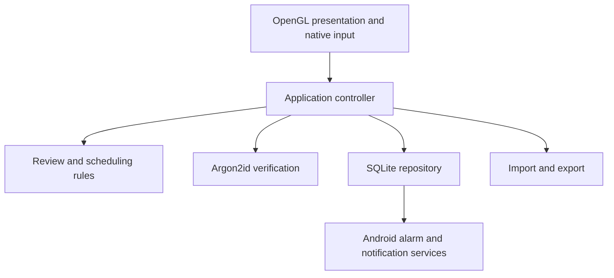

# Architecture

Neuro Granny is a local-first Android application. Application state lives in SQLite; the interface uses OpenGL ES for presentation and native Android controls for text entry.

## Boundaries

- **Presentation:** The OpenGL view displays scene snapshots; native controls handle keyboard input, selection and password masking.
- **Application logic:** Review decisions, secret verification and navigation are coordinated separately from storage and rendering.
- **Persistence:** SQLite holds records, review history and due state. Reminders are reconstructed from persisted state.
- **Import/export:** Backups are explicit user actions through Android's document picker, not background synchronization.

## Important invariants

- Verify-only records store a salted verifier rather than recoverable plaintext.
- Visual cues must not disclose a secret or derive their randomness from it.
- Incorrect answers do not complete a review.
- An unsuccessful or canceled import must leave the existing database unchanged.

See [Security](SECURITY.md), [Data and backup](DATA_AND_BACKUP.md), and [Android reliability](ANDROID_RELIABILITY.md) for behavioral constraints.
